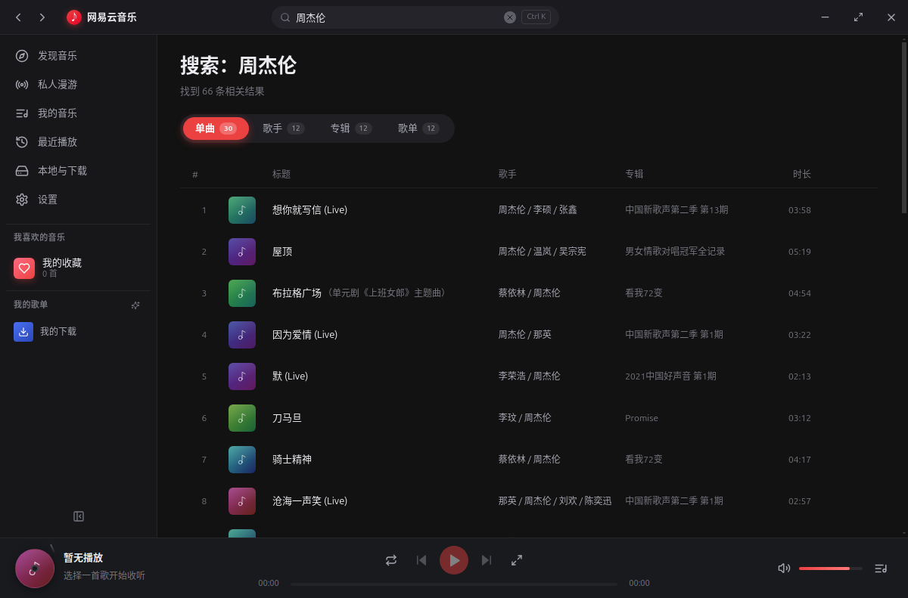
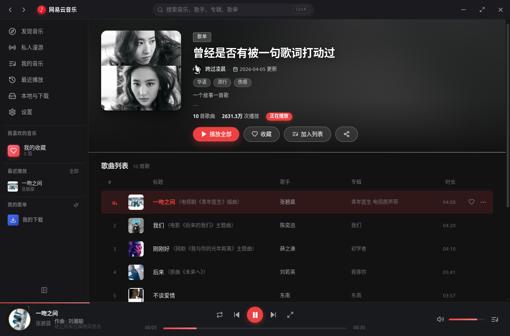
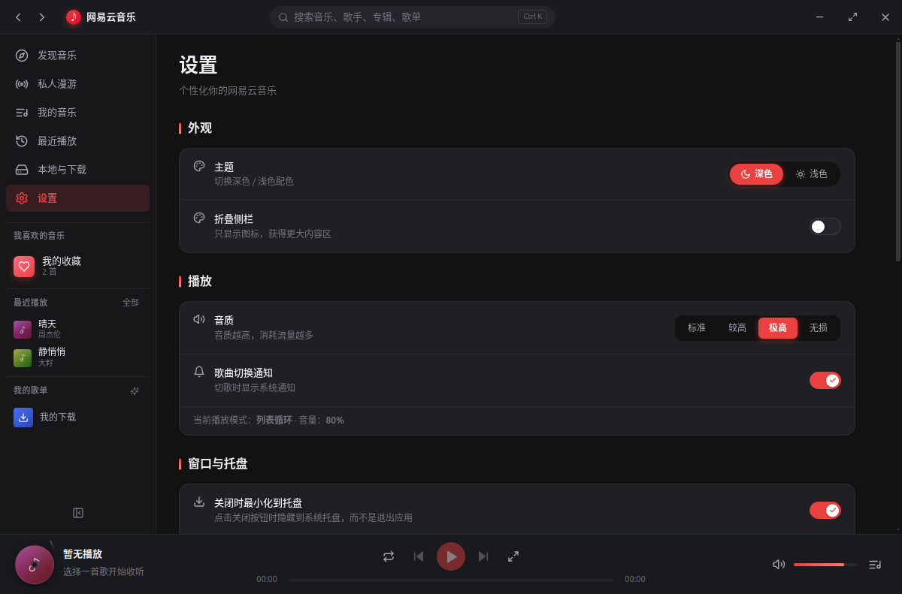
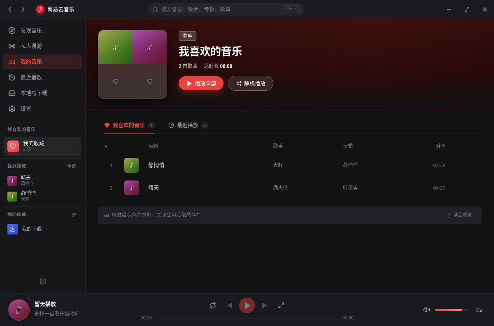
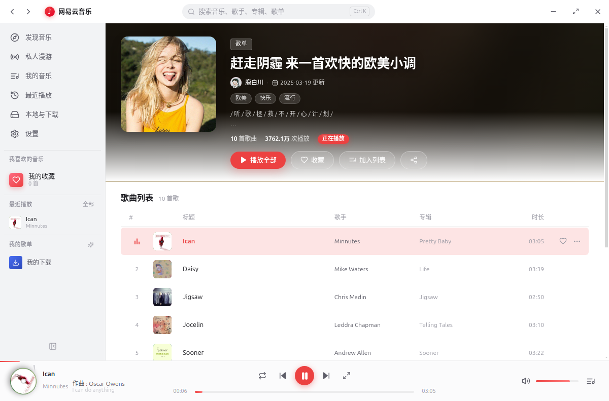

# 网易云音乐 Linux 客户端

一个功能完整的**非官方**网易云音乐 Linux 桌面客户端。基于 **Electron 33 + React 18 + TypeScript 5** 构建，提供接近官方客户端的界面与体验，并深度集成 Linux 桌面特性（MPRIS/D-Bus、系统托盘、全局媒体键、迷你播放器）。


---

## ✨ 功能特性

### 音乐浏览
- **发现音乐**：轮播推荐 Banner、推荐歌单网格、新歌速递、榜单卡片（含前 3 首试听预览）
- **排行榜**：飙升榜 / 新歌榜 / 原创榜 / 热歌榜 等榜单
- **搜索**：单曲 / 歌手 / 专辑 / 歌单 四类结果分类展示
- **歌单详情**：模糊封面头图 + 主题取色、播放全部、收藏、歌曲列表、右键菜单
- **专辑详情** / **歌手详情**：歌手简介、热门歌曲、专辑列表

### 播放
- 完整播放引擎：队列管理、四种播放模式（顺序 / 单曲循环 / 随机 / 列表循环）、音量、进度拖拽
- **同步歌词**：LRC 解析，支持多时间标签、翻译歌词双语显示、卡拉OK 式逐行高亮
- **播放详情页**：黑胶唱片旋转动画、模糊封面背景、大字歌词
- **音频缓存**：已播放音频缓存在 IndexedDB，二次播放零延迟
- 自动跳过无音源歌曲，弱网自动降级为演示模式（不崩溃）

### 账号
- **扫码登录**：手机网易云 App 扫一扫即可登录
- **Cookie 登录**：从浏览器复制 cookie 粘贴登录（兜底方案）
- 登录后同步：我创建的歌单、我收藏的歌单、收藏的歌曲、最近播放
- 登录态持久化在本地，重启自动恢复

### Linux 桌面集成
- **MPRIS / D-Bus**：`org.mpris.MediaPlayer2.netease-cloud-music`，被桌面环境的面板、锁屏、KDE/GNOME 媒体控件识别
- **系统托盘**：托盘图标 + 右键菜单（播放/暂停、上一首、下一首、显示/隐藏、退出）
- **全局媒体键**：键盘上的播放/暂停、上下曲、停止键
- **迷你播放器**：320×120 精简窗口，始终置顶
- **关闭到托盘**：可选关闭按钮最小化到托盘而非退出
- **自定义协议**：`netease-music://song/123` 深链接
- 窗口位置/大小记忆、浅色/深色主题

### 下载
- 单曲下载、批量下载、下载进度提示、下载目录可选
- 已下载歌曲在「本地与下载」页集中管理

---

## 📦 安装

> 安装包体积超过 GitHub 单文件限制（100MB），不放在仓库里。
> 请到 [**Releases**](https://github.com/dxy1151/wangyiyun_linux/releases) 页面下载，或按下方「从源码构建」自行打包。

### Debian / Ubuntu（deb）
```bash
sudo dpkg -i NeteaseCloudMusic-1.0.0-amd64.deb
sudo apt-get install -f      # 若提示缺少依赖
```

### Fedora / RHEL / openSUSE（rpm）
```bash
sudo rpm -ivh netease-cloud-music-1.0.0-1.x86_64.rpm
# 或： sudo dnf install ./netease-cloud-music-1.0.0-1.x86_64.rpm
```

### 任意发行版（AppImage，免安装）
```bash
chmod +x NeteaseCloudMusic-1.0.0-x86_64.AppImage
./NeteaseCloudMusic-1.0.0-x86_64.AppImage
```

安装后可从应用菜单启动，或命令行执行 `netease-cloud-music`。

> **关于沙箱**：若系统未正确配置 `chrome-sandbox`（非 root 安装常见），程序会自动检测并降级为 `--no-sandbox` 启动，不影响使用。

---

## 🖼 截图

| | |
|---|---|
|  |  |
| **发现音乐** | **搜索** |
|  |  |
| **歌单播放** | **全屏播放器（黑胶 + 歌词）** |
|  |  |
| **扫码登录** | **设置** |
|  |  |
| **我的音乐** | **浅色主题** |

---

## 🔧 从源码构建

```bash
# 环境要求：Node.js ≥ 18、npm ≥ 9
git clone git@github.com:dxy1151/wangyiyun_linux.git
cd wangyiyun_linux

npm install           # 首次安装（会下载 Electron 二进制，约 100MB）

npm run dev           # 开发模式（热更新）
npm run build         # 类型检查 + 构建到 out/
npm start             # 预览已构建产物

npm run dist          # 打包全部：AppImage + deb + rpm → release/
npm run dist:rpm      # 仅打包 rpm
```

### 国内网络加速

Electron 二进制下载慢或失败时：

```bash
export ELECTRON_MIRROR=https://npmmirror.com/mirrors/electron/
npm install
```

### 无 root 环境打包 RPM

本项目的 rpm 由 `scripts/build-rpm.py` 纯 Python 生成，**不依赖 rpmbuild**，因此在 Debian/Ubuntu、CI 容器里都能直接出包。

---

## 🏗 技术架构

```
┌─────────────────────────────────────────────────────────────┐
│                      主进程 (src/main)                       │
│  窗口/托盘 · MPRIS(D-Bus) · 媒体键 · 下载 · 设置 · 登录会话    │
│  └─ 纯 JS 实现的 D-Bus 协议栈（dbus-client.ts / dbus-codec.ts）│
└───────────────────────┬─────────────────────────────────────┘
                        │ contextBridge (window.nt)
┌───────────────────────┴─────────────────────────────────────┐
│                    渲染进程 (src/renderer)                   │
│  React 18 + zustand                                          │
│  ├─ api/     网易云接口适配 + 音源多源故障转移                 │
│  ├─ store/   播放引擎（player.ts）· 登录态（auth.ts）          │
│  ├─ pages/   10 个页面（发现/搜索/歌单/专辑/歌手/我的/…）       │
│  └─ components/  26+ 组件（播放栏/歌词/队列/卡片/…）           │
└─────────────────────────────────────────────────────────────┘
```

### 数据来源说明

| 数据 | 来源 |
|---|---|
| 搜索、歌单、榜单、歌词、歌手、专辑 | 网易云官方 Web API |
| 歌曲播放直链 | 公开镜像 API 多源探测 + 故障转移（320kbps mp3） |
| 封面图 | 官方 CDN（`?param=` 控制尺寸） |

> 所有网络请求均带 8 秒超时、自动重试与本地缓存；接口全部做兜底，**网络异常不会导致界面崩溃**。

---

## 📁 目录结构

```
├─ src/
│  ├─ main/                  # 主进程
│  │  ├─ index.ts            # 入口：生命周期编排
│  │  ├─ window.ts           # 窗口（无边框/迷你/位置持久化）
│  │  ├─ tray.ts             # 系统托盘
│  │  ├─ mpris/              # MPRIS 服务（自研 D-Bus 协议栈，零原生依赖）
│  │  ├─ mediakeys.ts        # 全局媒体键
│  │  ├─ auth.ts             # 账号登录（扫码 / Cookie）
│  │  ├─ download.ts         # 流式下载
│  │  ├─ settings.ts         # 设置持久化
│  │  └─ ipc.ts              # IPC 注册中心
│  ├─ preload/               # contextBridge 桥接层
│  ├─ shared/                # 跨进程共享类型与 IPC 通道常量
│  └─ renderer/src/          # React 应用
│     ├─ api/                # 数据层
│     ├─ store/              # player（播放引擎）/ auth / ui
│     ├─ pages/              # 页面
│     ├─ components/         # 组件
│     └─ styles/             # 主题与全局样式
├─ scripts/
│  ├─ build-rpm.py           # 纯 Python RPM 打包器
│  ├─ build-rpm.mjs          # npm run dist:rpm 入口
│  ├─ gen-icon.mjs           # 程序化生成应用图标
│  ├─ probe-api.mjs          # API 可用性探测
│  └─ test-player.mjs        # 播放引擎单元测试
├─ build/icon.png            # 应用图标
├─ packaging/                # rpm 用的启动脚本与 .desktop
├─ docs/                     # 接口契约 / API 笔记 / 播放器契约
└─ release/                  # 打包产物
```

---

## 🧪 测试与验证

```bash
npm run typecheck                 # TypeScript 类型检查（0 错误）
node scripts/test-player.mjs      # 播放引擎 42 项断言
node scripts/probe-api.mjs        # 数据源可用性探测（33 个用例）
```

已验证项：
- ✅ 真实播放（音频流式播放、进度推进、切歌、四种播放模式）
- ✅ 歌词同步与双语显示
- ✅ 扫码登录二维码生成与状态轮询
- ✅ MPRIS 四条标准验证（ListNames / Introspect / GetAll / PlayPause）
- ✅ 三种安装包格式生成与结构校验（rpm 经真实 rpm 工具验证）

---

## ⚠️ 免责声明

- 本项目为**非官方**第三方客户端，与网易公司无关。
- 项目仅用于学习 Linux 桌面应用开发与 Electron 技术实践。
- 音乐版权归网易云音乐及各版权方所有，请支持正版。
- 使用本软件产生的任何后果由使用者自行承担。

---

## 📄 许可证

MIT License

---

## 🔗 相关文档

- [接口契约（开发者）](docs/dev-contract.md)
- [数据源与 API 笔记](docs/api-notes.md)
- [播放器 UI 契约](docs/player-contract.md)
